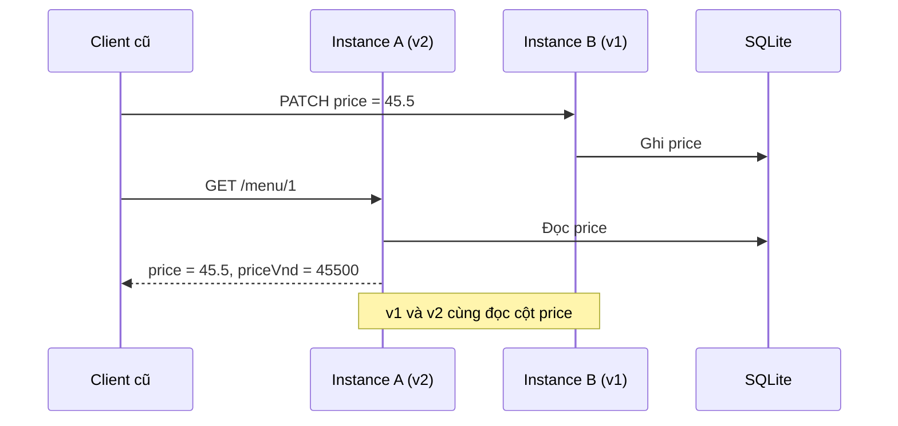
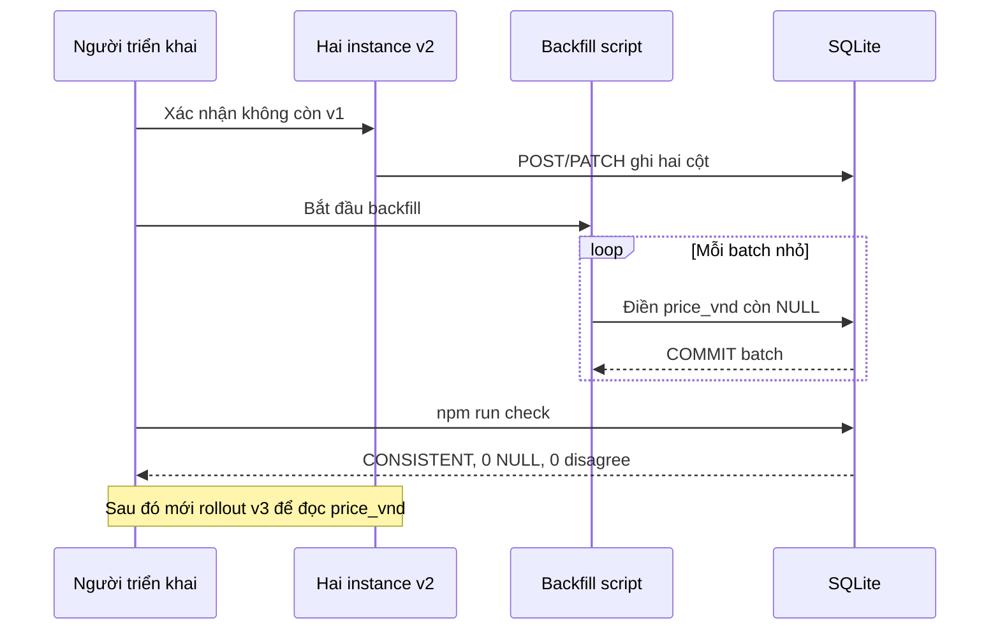
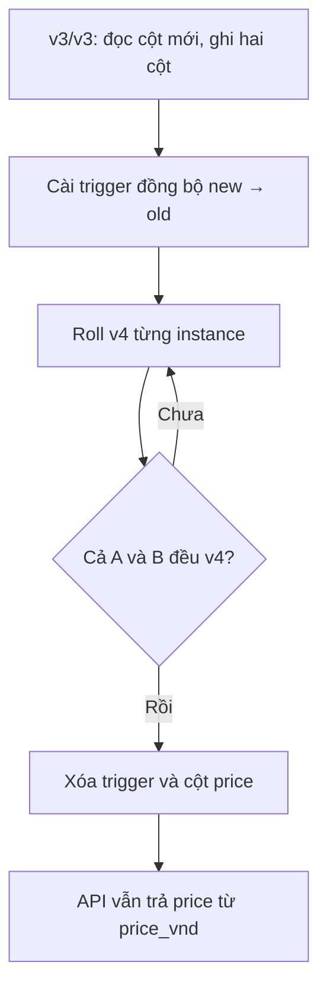
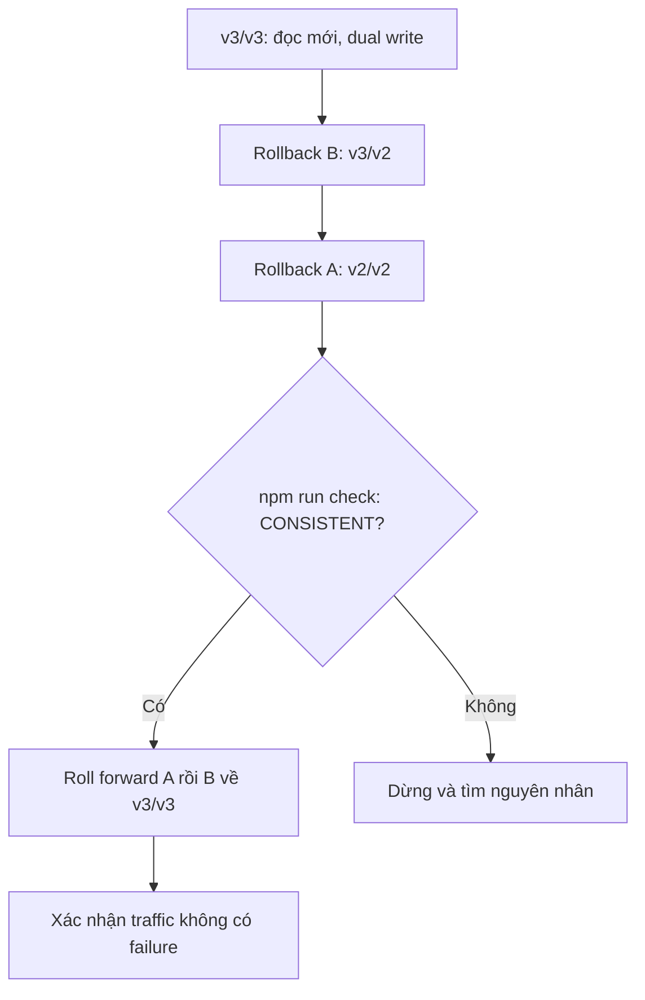

# IA#2 — Tóm tắt lý thuyết Database Migration

Tài liệu ngắn để hiểu *vì sao* từng bước có mặt trong [MIGRATION.md](../MIGRATION.md). Đây là ví dụ thực hành với SQLite; trên PostgreSQL còn phải chú ý lock và cách chạy DDL riêng.

## 1. Schema migration là gì?

**Schema** là cấu trúc bảng/cột/ràng buộc. **Migration** là thay đổi có phiên bản đối với schema: một file `.up.sql` để tiến lên và `.down.sql` để lùi lại.

- Trước: `menu_items.price REAL`, đơn vị **nghìn VNĐ** (45.5 = 45.500 VNĐ).
- Sau: `menu_items.price_vnd INTEGER`, đơn vị **VNĐ** (45500).
- `order_items.unit_price` **không đổi** theo đề bài.

**Vì sao cần đổi?** Số tiền nên biểu diễn bằng đơn vị nguyên nhỏ nhất để tránh lỗi do biểu diễn số thực và hiểu nhầm đơn vị.

## 2. Expand → Migrate → Contract

| Pha | Thực hiện | Vì sao an toàn |
|---|---|---|
| **Expand** | Thêm `price_vnd` có thể NULL; giữ `price` | Code v1 vẫn đọc/ghi được |
| **Migrate** | v2 dual-write, backfill, v3 đọc cột mới, rollback thử | Không cần chuyển tất cả instance trong một thời điểm |
| **Contract** | Sau khi mọi instance chỉ dùng cột mới, bỏ `price` | Không còn query nào đòi cột cũ |

### Giai đoạn A — Expand: schema mở rộng, code cũ vẫn chạy

Trong lúc A đã lên **v2** còn B vẫn là **v1**, cả hai đọc cột cũ. v2 có thể tính `priceVnd` để trả về ngay cả khi bản ghi chưa backfill. Chưa cho client mới gửi request tới v1.

### Giai đoạn B — Migrate: dual write, backfill, chuyển nguồn đọc

Điều kiện chuyển sang **v3** là không còn dữ liệu thiếu hoặc lệch. Ở v3, hai cột vẫn được ghi đồng thời để có thể quay về v2.

### Giai đoạn C — Contract: loại bỏ phụ thuộc cột cũ

**Point of no return về vận hành:** sau khi đã xóa cột `price`, không được khởi động thẳng v1/v2/v3. Muốn quay lại phải phục hồi schema trước, kiểm tra dữ liệu, rồi mới cân nhắc rollback code.

Đừng `RENAME COLUMN price TO price_vnd` hoặc đổi loại trực tiếp khi v1 còn chạy: code v1 sẽ gọi tên cột không tồn tại.

## 3. Dual write và source of truth

**Dual write**: một request tạo món hoặc đổi giá ghi hai biểu diễn trong **cùng transaction / câu SQL**, ví dụ `price=45.5` và `price_vnd=45500`.

- **v2**: đọc `price` làm nguồn chính, ghi cả hai. An toàn khi còn v1, vì v1 chỉ biết cột cũ.
- **v3**: đọc `price_vnd` làm nguồn chính, vẫn ghi cả hai. Có thể rollback sang v2.
- **v4**: chỉ đọc/ghi `price_vnd`; JSON vẫn có `price` tính ra từ cột mới.

Nếu v4 chạy cùng v3 trước khi drop, có thể dùng trigger đồng bộ `price_vnd → price` để `npm run check` không phát hiện lệch. Trigger chỉ là **cầu chuyển tiếp**, phải bỏ khi Contract.

## 4. Backfill khác migration schema

**Backfill** là cập nhật dữ liệu *đã tồn tại*. Thêm cột không tự làm đầy 20.000 giá trị mới.

Ví dụ chuyển đổi:

`price_vnd = ROUND(price * 1000)`

**Batch processing** chia dữ liệu thành nhóm nhỏ (ví dụ 200 dòng), mỗi nhóm là một transaction ngắn. Thời gian giữ khóa thấp hơn một transaction khổng lồ.

**Idempotent / resumable**: chạy lại script không làm dữ liệu sai hoặc nhân đôi; ví dụ chỉ điền những dòng `price_vnd IS NULL`. Cần xử lý viết đồng thời để backfill không ghi đè lần đổi giá mới.

**Rào chắn quan trọng**: không backfill khi còn instance v1 chỉ ghi `price`. Phải đợi v2/v2 trước.

## 5. Rolling deployment và zero downtime

Hai instance cùng dùng một database, ví dụ:

`A=v1, B=v1 → A=v2, B=v1 → A=v2, B=v2`

Khi một instance khởi động lại, instance kia vẫn nhận request. `rerouted` không phải thất bại; cả hai cùng down mới có `unavailable`.

**Backward compatibility**: code mới hiểu schema cũ/mở rộng. **Forward compatibility** trong bài là phiên bản cũ còn chạy được khi schema mới đã thêm cột. Chỉ kết hợp các version được đánh dấu an toàn trong bảng migration.

## 6. API contract và client cũ/mới

**Database schema** khác **HTTP API contract**.

- Client cũ vẫn gửi và nhận `price` số thực, đơn vị nghìn VNĐ.
- Client mới gửi/nhận `priceVnd` số nguyên, đơn vị VNĐ.
- Mọi response menu vẫn cần `price` ngay cả khi cột database `price` bị xóa.
- Đơn hàng hiện giữ `unit_price` và `total` theo đơn vị cũ.

Ví dụ sau Contract: DB có `price_vnd=45500`, JSON trả `{ "price": 45.5, "priceVnd": 45500 }`. Không cần cột `price` để trả field `price`.

## 7. Consistency, stale reads và traffic

**Consistency** trong bài: với hai cột, `price_vnd = ROUND(price * 1000)` cho mỗi dòng đã backfill; không còn NULL trước khi code đọc cột mới.

**Stale read**: client đã nhận xác nhận PATCH, nhưng GET sau đó trả giá cũ. Điều này có thể xảy ra khi một version đọc `price` còn version khác chỉ ghi `price_vnd`.

`npm run traffic` đo request thực sự đọc/ghi. Những bản ghi chưa được đọc vẫn có thể sai; do đó `npm run check` kiểm tra toàn bảng là bằng chứng thứ hai.

Counters:
- `error` = 5xx;
- `contract` = JSON/status không đúng hợp đồng;
- `stale` = đọc giá cũ sau write thành công;
- `unavailable` = không instance nào phục vụ;
- `rerouted` = gửi lại qua instance còn sống, không tính là failure.

## 8. Rollback, down migration và point of no return

**Rollback code**: quay v3→v2 khi cả hai còn dual-write, vẫn đảm bảo dữ liệu khớp.

**Down migration**: chạy `npm run migrate:down` để hoàn tác *schema step cuối cùng*. Đây **không đồng nghĩa** với việc rollback code luôn an toàn. Cần kiểm tra phiên bản nào đang chạy trước.

**Point of no return (về vận hành)**: sau khi drop cột `price`, không thể đơn giản khởi động lại v1/v2/v3; query đòi cột cũ có thể lỗi. Một bản `004.down.sql` có thể mô tả phương án phục hồi có kiểm soát bằng cách tái tạo giá từ `price_vnd`, nhưng đó là recovery schema trước khi deploy code cũ, không phải rolling rollback một bước.

### Luồng rollback bắt buộc trong lúc traffic vẫn chạy

Không chạy `migrate:down` trong thử nghiệm rollback code v3↔v2 này: cả hai phiên bản cần giữ nguyên schema mở rộng và cùng dual-write.

## 9. Git tag và worktree

- **Tag**: neo một commit code cụ thể (v1, v2, v3, v4) để tái hiện triển khai.
- **Worktree**: nhiều thư mục checkout các tag khác nhau, giúp chạy v2 ở port 3001 và v1 ở port 3002.
- Tất cả process phải dùng cùng **DB_PATH tuyệt đối**. Nếu không, mỗi worktree có thể vô tình tạo database riêng.

## 10. Log và bằng chứng

- **`traffic-log.txt`**: một lần chạy liên tục từ v1 tới sau Contract. Restart traffic là mất bằng chứng một lần chạy.
- **`check-log.txt`**: kết quả `npm run check` có nhãn sau **mọi** bước; log thêm các lần thử `.down.sql` trên DB riêng.
- **`AI-LOG.md`**: nêu AI hỗ trợ gì, giữ/sửa/bỏ gì, phần tự làm. Dùng AI được phép; phải hiểu và giải thích code.
- **Self-assessment**: tự cho điểm theo từng tiêu chí và chỉ ra bằng chứng kiểm chứng được.

### Một bẫy của starter

`NEW_CLIENTS` chỉ được đọc khi `traffic.js` bắt đầu. Để vừa có traffic **một lần liên tục** vừa bật client mới sau khi mọi instance lên v2, coding agent nên thêm cách đọc lại cấu hình trong lúc chạy (ví dụ file tỷ lệ được thay thế atomically) và ghi thời điểm chuyển vào chính traffic log. Không được sửa logic đánh giá failure.
